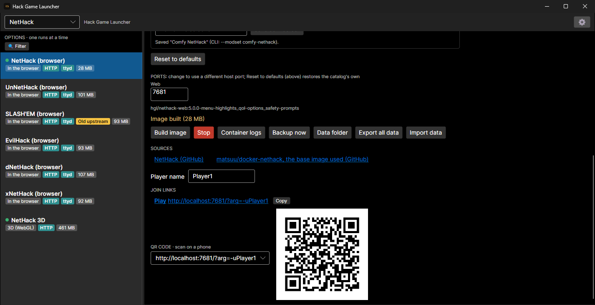
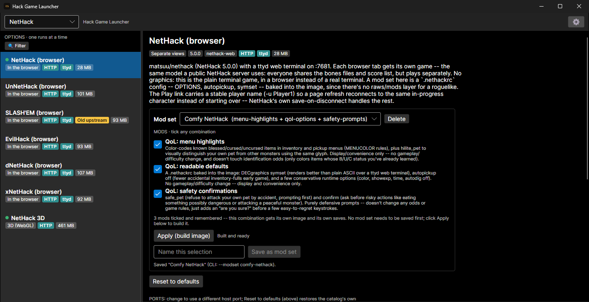
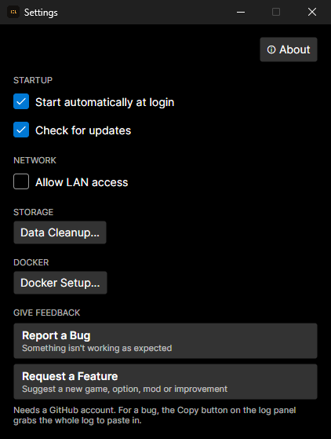

# HGL: Hack Game Launcher

HGL is a desktop launcher for classic roguelikes and Dwarf Fortress. Pick a game, click **Build image**, then **Start**. HGL runs the game in a Docker container and gives you a link to play it in your web browser, on the same computer or on another device on your network.

- **One click to play:** no installing each game or its tools by hand. HGL downloads and sets up everything a game needs.
- **Play together:** many options are multiplayer. Some share one screen, some give each player their own view, and some let players take turns on one save.
- **Mods:** tick the mods you want per game, save your favourite combinations, and add your own Dwarf Fortress mod files.
- **Your saves stay yours:** each game and mod combination keeps its own saves, with one-click backups and export/import for moving to a new computer.

## Download

**[Latest release](https://github.com/hackgamelauncher/Hack-Game-Launcher/releases/latest)**

| Platform | File |
|---|---|
| Windows | `Hack-Game-Launcher-<version>-x64-Setup.exe` |
| macOS (Intel and Apple Silicon) | `Hack-Game-Launcher-<version>-macos-universal.dmg`, or the `.zip` of the app |
| Linux, Debian/Ubuntu | `Hack-Game-Launcher-<version>-amd64.deb` (or `-arm64.deb`) |
| Linux, Fedora/RHEL | `Hack-Game-Launcher-<version>-x86_64.rpm` (or `-aarch64.rpm`) |
| Linux, any distro | `Hack-Game-Launcher-<version>-x86_64.AppImage` (or `-aarch64`), or the `.tar.gz` |

HGL needs [Docker](https://www.docker.com/products/docker-desktop/) installed and running.

## Games

| Game | What you get |
|---|---|
| **Dwarf Fortress** | Shared-screen hotseat, co-op with separate views, save hand-off between players, and the DF Remote iOS app. Classic (free) versions download automatically; Premium uses your own purchased copy. |
| **NetHack** | NetHack plus the UnNetHack, SLASH'EM, EvilHack, dNetHack and xNetHack variants, all in a browser terminal, plus NetHack 3D. |
| **Dungeon Crawl Stone Soup** | The browser WebTiles version with player accounts, and a graphics + sound version. |
| **Angband** | A browser terminal version, and a graphics + sound version with an optional graphical tileset. |
| **Pathos** | Graphics + sound. HGL downloads the game from its official site if you don't have it. |

## Screenshots

<table>
  <tr>
    <td width="50%"></td>
    <td width="50%"></td>
  </tr>
  <tr>
    <td>Tick the mods you want and save the combination under your own name.</td>
    <td>A running game's join link, with a QR code to open it on a phone.</td>
  </tr>
  <tr>
    <td></td>
    <td>Settings: start at login, update checks, LAN access for other devices, cleaning up old game images, Docker setup help, and bug reports or feature requests.</td>
  </tr>
</table>

## Phones and tablets

Every game is meant to be playable from a phone or tablet browser as well as a desktop one. Each has an on-screen touch keypad with direction pad, modifier keys and hold-to-repeat, plus per-game command buttons, and the layout adapts to portrait and landscape. Open the game's join link, or scan its QR code in the launcher, from any device on the same network.

Mobile support is new. If a game doesn't work well on your phone, please [open an issue](https://github.com/hackgamelauncher/Hack-Game-Launcher/issues).

## Good to know

- Several options are built on old community projects (for example DFPlex and DF Remote, which only work with older Dwarf Fortress versions). The launcher marks these "Old upstream" and says which game version they need.
- Games are reachable only from your own computer by default. Allowing other devices on your network is a setting in the launcher.
